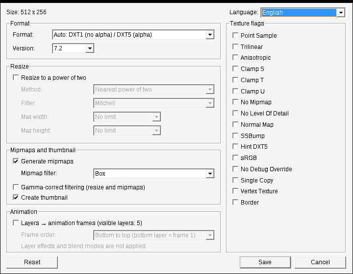

# VTF Export — Valve Texture Format plug-in for Photoshop (x64)

[Русская версия](README.ru.md)

Open and save **Valve Texture Format (`.vtf`)** files — the texture format of the Source engine
(Half-Life 2, Counter-Strike: Source, Garry's Mod, Team Fortress 2, Portal, …) — directly in
modern 64-bit Adobe Photoshop on Windows.

It replaces the old 32-bit `VTF.8bi` plug-in, which does not load in 64-bit Photoshop.
No external DLLs: VTFLib is not needed, DXT compression is built in.



## Features

**Opening**
- VTF 7.0 – 7.5, almost every format: DXT1/3/5, DXT1 with 1-bit alpha, ATI1N/ATI2N, all 8-bit
  RGB(A)/BGR(A)/ABGR/ARGB/BGRX, 565/5551/4444, I8/IA88/A8, UV88/UVWQ/UVLX, bluescreen,
  HDR 16/32-bit (clamped to 0..1).
- Alpha opens as the alpha channel "Alpha 1".
- **Animated textures open as layers** ("Frame 1", "Frame 2", …).
- Cubemaps and volume textures: the first face / slice is opened (with a warning).
- Re-saving an opened VTF pre-fills its format, version, mipmaps and flags.

**Saving**
- Formats: **Auto DXT1 / DXT5** (default — DXT5 only if the image has alpha), **Auto BGR888 / BGRA8888**,
  or exactly DXT1, DXT3, DXT5, BGR888, BGRA8888, RGB888, RGBA8888, BGR565, BGRA4444, BGRA5551, I8, IA88, A8.
- VTF versions 7.1 – 7.5.
- Mipmaps with 15 filters (all VTFEdit filters + Lanczos), optional gamma-correct filtering;
  16×16 DXT1 thumbnail like Valve's tools.
- Resize to a power of two (nearest / larger / smaller) with a filter and max width / height;
  the final size is shown in the dialog.
- Texture flags (Point Sample, Trilinear, Anisotropic, Clamp S/T/U, No Mipmap, No LOD, Normal Map,
  SSBump, sRGB, …); one/eight-bit alpha flags are set automatically.
- **Visible layers → animation frames.**
- RGB and Grayscale documents, 8/16/32 bits per channel.
- Remembers the last used settings.

**Interface:** English, Русский, Deutsch built in; more languages can be added (see [Translations](#translations)).

## Installation

1. Download `VTFExport-<version>.zip` from [Releases](../../releases).
2. Close Photoshop.
3. Copy `VTFExport.8bi` into Photoshop's plug-in folder, for example
   `C:\Program Files\Adobe\Adobe Photoshop 2026\Plug-ins\` (needs administrator rights).
   Optionally copy the `VTFExport_lang` folder next to it (only needed for your own translations).
4. Start Photoshop.

Requires 64-bit Photoshop for Windows (any version that loads 64-bit format plug-ins; developed
and tested with Photoshop 2026 / 27.x).

## Usage

- **Open:** *File → Open…* and pick a `.vtf`, or drag the file into Photoshop.
- **Save:** *File → Save a Copy…* (`Ctrl+Alt+S`) → **Valve Texture Format (\*.VTF)**.
  Recent Photoshop versions list third-party formats under *Save a Copy*, not *Save As*.

The options dialog appears before saving. If the size is not a power of two and resizing is off,
the plug-in warns you (Source may display such textures incorrectly) but lets you save anyway.

### Which mipmap / resize filter?

| Filter | Look | Use for |
|---|---|---|
| **Box** | soft (default, like VTFEdit) | safe choice |
| **Mitchell** | balanced | general purpose, resizing |
| **Kaiser** / **Lanczos** | sharp | small details (text, grids, patterns) that must stay readable at a distance |

Gaussian and Cubic are the softest; Sinc, Catmull-Rom and the windowed sincs are sharper but may
ring slightly on high-contrast edges. *Gamma-correct filtering* keeps the brightness of fine light
or dark details in the mips; leave it off for normal maps, masks and other non-colour data.

Edges: unless **Clamp S / Clamp T** is set, the texture is treated as tiling while filtering, so
mipmaps of tiling textures stay seamless.

### Animation

**Opening:** every frame becomes a layer. To play it in Photoshop: *Window → Timeline* →
*Create Frame Animation* → panel menu → **Make Frames From Layers**. VTF files have no frame rate;
it is set in the `.vmt` (`animatedtextureframerate` of the `AnimatedTexture` proxy).

**Saving:** in the *Animation* box of the dialog:
- **Layers → animation frames** — every visible layer becomes a frame. Off by default; greyed out
  when there are fewer than two visible layers; pre-checked for documents opened from an animated
  VTF (Photoshop remembers this only while the document stays open).
- **Frame order** — bottom to top (bottom layer = frame 1, same as *Make Frames From Layers*) or
  top to bottom. Remembered. A document opened from a VTF is saved back in the order it was opened.
- Only **visible** layers are used; adjustment layers and groups are skipped — hide a layer to
  leave it out.
- Frames use the raw layer pixels: transparency × layer mask × opacity × fill.
  **Layer styles, blend modes and adjustment layers are not applied** — rasterize such layers first.
- *Auto* formats look at all frames: if any frame has alpha, all frames use DXT5.

Note: Photoshop may not keep the colour of fully transparent layer pixels. If the alpha of an
animation is a mask (not transparency) and the colour under it matters, check the result.

## Translations

The dialog language is chosen at the top right of the save dialog (*Auto* = Windows language).

Sources, each overriding the previous one **string by string**:
1. English — compiled in (`src/Lang.cpp`); fallback for any missing string;
2. `lang/*.lang` files of this repository — embedded into the plug-in at build time;
3. `*.lang` files in the `VTFExport_lang` folder next to `VTFExport.8bi` — no rebuild needed.

A file with the same `language.code` as a built-in language does not add a second entry; it only
replaces the strings it contains — handy for fixing a few strings.

**Adding a language:** start from [`lang/template.lang.txt`](lang/template.lang.txt), save it as
`lang/<code>.lang` (UTF-8), set `language.name` and `language.code`, translate, check with
`python tools/check_lang.py`, and open a pull request. Details: [CONTRIBUTING.md](CONTRIBUTING.md).

**Without rebuilding:** put the file into `VTFExport_lang` next to the plug-in. Languages are
re-read every time the dialog opens. The folder path is shown in
*Help → About Plug-In → VTF Export*.

## Building from source

1. **Visual Studio 2022 or 2026** (Community is fine) with *Desktop development with C++*.
2. **Photoshop C++ SDK** (free, requires an Adobe ID): [Adobe Developer Console](https://developer.adobe.com/developer-console/)
   → *APIs and services* → *Photoshop Plug-In and Connection SDK* (Windows).
   The SDK may not be redistributed, so it is not part of this repository. Unpack it so that this
   file exists:
   ```
   photoshop_sdk\pluginsdk\photoshopapi\photoshop\PIFormat.h
   ```
   (or build with `msbuild VTFExport.sln /p:PhotoshopSdkDir=D:\path\to\sdk\` — the folder that
   contains `pluginsdk`, trailing backslash required).
3. Open `VTFExport.sln`, select **Release | x64**, build.
   Output: `bin\Release\VTFExport.8bi` and `bin\Release\VTFExport_lang\`.

The pre-build step embeds `lang\*.lang` with `tools\embed_lang.ps1` (PowerShell); the PiPL
resource is compiled with the SDK's `Cnvtpipl.exe`.

Release archive: `powershell -ExecutionPolicy Bypass -File tools\make_release.ps1`
→ `dist\VTFExport-<version>.zip`. The script refuses to pack a plug-in that contains the
path of your build folder (it would reveal your user name).

### Tests

The core (encoder, decoder, filters, animation) and the plug-in itself are tested on Linux
without Photoshop or the SDK:

```sh
pip install srctools pillow
tests/run_tests.sh          # core: g++ + python
tests/run_tests.sh --wine   # + plug-in under Wine with fake Photoshop hosts (needs MinGW + Wine)
```

Independent reference: the VTF reader of [srctools](https://github.com/TeamSpen210/srctools).
The fake hosts use `tests/sdk_stub/` — a minimal stand-in for the SDK headers written for this
project; the real plug-in is always built against the real SDK.

## Project layout

```
src/            plug-in source (VtfWriter/VtfReader/Resample are platform-independent)
lang/           translations embedded at build time (+ template.lang.txt)
tools/          embed_lang (build), check_lang (translation checker), make_release
tests/          test suite, sdk_stub for the fake hosts
third_party/    stb_dxt.h (DXT compressor, public domain)
photoshop_sdk/  put the Photoshop SDK here (not in the repository)
docs/           screenshots
```

## License

[MIT](LICENSE). Third-party code: see [THIRD_PARTY_NOTICES.md](THIRD_PARTY_NOTICES.md).
Adobe and Photoshop are trademarks of Adobe; Valve and Source are trademarks of Valve Corporation.
This project is not affiliated with either.
