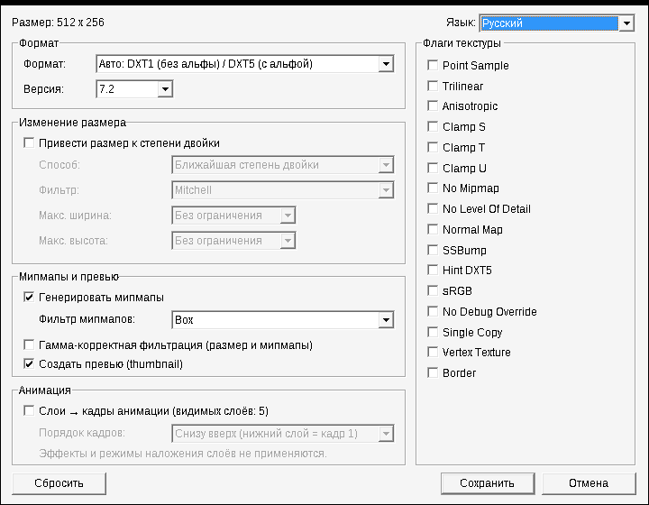

# VTF Export — плагин Valve Texture Format для Photoshop (x64)

[English version](README.md)

Открытие и сохранение файлов **Valve Texture Format (`.vtf`)** — формата текстур движка Source
(Half-Life 2, Counter-Strike: Source, Garry's Mod, Team Fortress 2, Portal, …) — прямо в
современном 64-битном Adobe Photoshop под Windows.

Заменяет старый 32-битный плагин `VTF.8bi`, который 64-битный Photoshop не загружает.
Внешних DLL нет: VTFLib не нужен, DXT-сжатие встроено.



## Возможности

**Открытие**
- VTF 7.0 – 7.5, почти все форматы: DXT1/3/5, DXT1 с 1-битной альфой, ATI1N/ATI2N, все 8-битные
  RGB(A)/BGR(A)/ABGR/ARGB/BGRX, 565/5551/4444, I8/IA88/A8, UV88/UVWQ/UVLX, bluescreen,
  HDR 16/32 бит (обрезается до 0..1).
- Альфа открывается как альфа-канал «Alpha 1».
- **Анимированные текстуры открываются слоями** («Кадр 1», «Кадр 2», …).
- Кубмапы и объёмные текстуры: открывается первая грань / срез (с предупреждением).
- При пересохранении открытого VTF подставляются его формат, версия, мипмапы и флаги.

**Сохранение**
- Форматы: **Авто DXT1 / DXT5** (по умолчанию — DXT5, только если есть альфа),
  **Авто BGR888 / BGRA8888** или конкретно DXT1, DXT3, DXT5, BGR888, BGRA8888, RGB888, RGBA8888,
  BGR565, BGRA4444, BGRA5551, I8, IA88, A8.
- Версии VTF 7.1 – 7.5.
- Мипмапы с 15 фильтрами (все фильтры VTFEdit + Lanczos), гамма-корректная фильтрация по желанию;
  превью 16×16 DXT1, как у инструментов Valve.
- Приведение размера к степени двойки (ближайшая / большая / меньшая) с фильтром и ограничением
  ширины / высоты; итоговый размер виден в окне.
- Флаги текстуры (Point Sample, Trilinear, Anisotropic, Clamp S/T/U, No Mipmap, No LOD, Normal Map,
  SSBump, sRGB, …); флаги 1/8-битной альфы ставятся автоматически.
- **Видимые слои → кадры анимации.**
- Документы RGB и Grayscale, 8/16/32 бита на канал.
- Последние настройки запоминаются.

**Интерфейс:** встроены English, Русский, Deutsch; можно добавлять свои языки (см. [Переводы](#переводы)).

## Установка

1. Скачать `VTFExport-<версия>.zip` в разделе [Releases](../../releases).
2. Закрыть Photoshop.
3. Скопировать `VTFExport.8bi` в папку плагинов Photoshop, например
   `C:\Program Files\Adobe\Adobe Photoshop 2026\Plug-ins\` (нужны права администратора).
   Папку `VTFExport_lang` можно положить рядом — она нужна только для своих переводов.
4. Запустить Photoshop.

Нужен 64-битный Photoshop для Windows (любая версия, загружающая 64-битные плагины форматов;
разработка и проверка — Photoshop 2026 / 27.x).

## Использование

- **Открыть:** *Файл → Открыть…*, выбрать `.vtf`, или перетащить файл в Photoshop.
- **Сохранить:** *Файл → Сохранить копию…* (`Ctrl+Alt+S`) → **Valve Texture Format (\*.VTF)**.
  В новых версиях Photoshop сторонние форматы есть в «Сохранить копию», а не в «Сохранить как».

Перед сохранением появляется окно настроек. Если размер не степень двойки, а ресайз выключен,
плагин предупредит (Source может показывать такие текстуры неправильно), но сохранить позволит.

### Какой фильтр выбрать

| Фильтр | Характер | Когда брать |
|---|---|---|
| **Box** | мягкий (по умолчанию, как в VTFEdit) | безопасный выбор |
| **Mitchell** | сбалансированный | универсально, при изменении размера |
| **Kaiser** / **Lanczos** | резкий | мелкие детали (надписи, сетки, узоры) должны читаться издали |

Gaussian и Cubic — самые мягкие; Sinc, Catmull-Rom и оконные sinc резче, но на контрастных краях
могут давать лёгкий ореол. *Гамма-корректная фильтрация* сохраняет яркость тонких светлых и тёмных
деталей в мипах; для карт нормалей, масок и прочих «данных» её лучше не включать.

Края: если не стоит флаг **Clamp S / Clamp T**, текстура при фильтрации считается повторяющейся,
поэтому мипмапы тайлящихся текстур остаются бесшовными.

### Анимация

**Открытие:** каждый кадр становится слоем. Чтобы проиграть в Photoshop: *Окно → Шкала времени* →
«Создать анимацию кадров» → меню панели → **«Создать кадры из слоёв»**. Частоты кадров в VTF нет —
она задаётся в `.vmt` (`animatedtextureframerate` прокси `AnimatedTexture`).

**Сохранение:** блок «Анимация» в окне сохранения:
- **«Слои → кадры анимации»** — каждый видимый слой становится кадром. По умолчанию выключено;
  серое, если видимых слоёв меньше двух; включается само для документа, открытого из анимированного
  VTF (Photoshop помнит это, пока документ открыт).
- **«Порядок кадров»** — снизу вверх (нижний слой = кадр 1, как «Создать кадры из слоёв») или
  сверху вниз. Запоминается. Документ, открытый из VTF, сохраняется в том же порядке, в котором открыт.
- Используются только **видимые** слои; корректирующие слои и группы пропускаются — скройте слой,
  чтобы исключить кадр.
- Берутся «сырые» пиксели слоя: прозрачность × маска × непрозрачность × заливка.
  **Стили слоя, режимы наложения и корректирующие слои не применяются** — такие слои сначала растрируйте.
- Форматы «Авто» учитывают все кадры: если альфа есть хотя бы в одном, все кадры будут DXT5.

Photoshop может не хранить цвет полностью прозрачных пикселей слоя. Если альфа анимации — это маска,
а не прозрачность, и цвет под ней важен, проверьте результат.

## Переводы

Язык выбирается справа вверху в окне сохранения («Авто» — язык Windows).

Источники, каждый следующий перекрывает предыдущий **построчно**:
1. английский — в коде (`src/Lang.cpp`), запасной вариант для любой строки;
2. файлы `lang/*.lang` репозитория — вшиваются в плагин при сборке;
3. файлы `*.lang` в папке `VTFExport_lang` рядом с `VTFExport.8bi` — без пересборки.

Файл с тем же `language.code`, что у встроенного языка, не добавляет второй пункт в список, а только
заменяет строки, которые в нём есть — удобно, чтобы поправить пару строк.

**Добавить язык:** взять [`lang/template.lang.txt`](lang/template.lang.txt), сохранить как
`lang/<код>.lang` (UTF-8), указать `language.name` и `language.code`, перевести, проверить
`python tools/check_lang.py` и открыть pull request. Подробно: [CONTRIBUTING.md](CONTRIBUTING.md).

**Без пересборки:** положить файл в `VTFExport_lang` рядом с плагином. Языки перечитываются при
каждом открытии окна. Путь к папке показан в *Справка → О внешнем модуле → VTF Export*.

## Сборка из исходников

1. **Visual Studio 2022 или 2026** (подойдёт Community) с нагрузкой «Разработка классических
   приложений на C++».
2. **Photoshop C++ SDK** (бесплатно, нужен Adobe ID): [Adobe Developer Console](https://developer.adobe.com/developer-console/)
   → *APIs and services* → *Photoshop Plug-In and Connection SDK* (Windows).
   SDK нельзя распространять, поэтому в репозитории его нет. Распакуйте так, чтобы существовал файл
   ```
   photoshop_sdk\pluginsdk\photoshopapi\photoshop\PIFormat.h
   ```
   (или соберите с `msbuild VTFExport.sln /p:PhotoshopSdkDir=D:\путь\к\sdk\` — папка, в которой
   лежит `pluginsdk`, обратный слэш в конце обязателен).
3. Открыть `VTFExport.sln`, выбрать **Release | x64**, собрать.
   Результат: `bin\Release\VTFExport.8bi` и `bin\Release\VTFExport_lang\`.

Перед сборкой `tools\embed_lang.ps1` (PowerShell) вшивает `lang\*.lang`, ресурс PiPL собирается
утилитой SDK `Cnvtpipl.exe`.

Архив релиза: `powershell -ExecutionPolicy Bypass -File tools\make_release.ps1`
→ `dist\VTFExport-<версия>.zip`.

### Тесты

Ядро (кодировщик, декодер, фильтры, анимация) и сам плагин проверяются на Linux без Photoshop и SDK:

```sh
pip install srctools pillow
tests/run_tests.sh          # ядро: g++ + python
tests/run_tests.sh --wine   # + плагин под Wine с эмуляторами Photoshop (нужны MinGW и Wine)
```

Независимая сверка — VTF-ридер [srctools](https://github.com/TeamSpen210/srctools).
Эмуляторы используют `tests/sdk_stub/` — минимальную замену заголовков SDK, написанную для этого
проекта; настоящий плагин всегда собирается с настоящим SDK.

## Лицензия

[MIT](LICENSE). Сторонний код: [THIRD_PARTY_NOTICES.md](THIRD_PARTY_NOTICES.md).
Adobe и Photoshop — товарные знаки Adobe; Valve и Source — товарные знаки Valve Corporation.
Проект с ними не связан.
